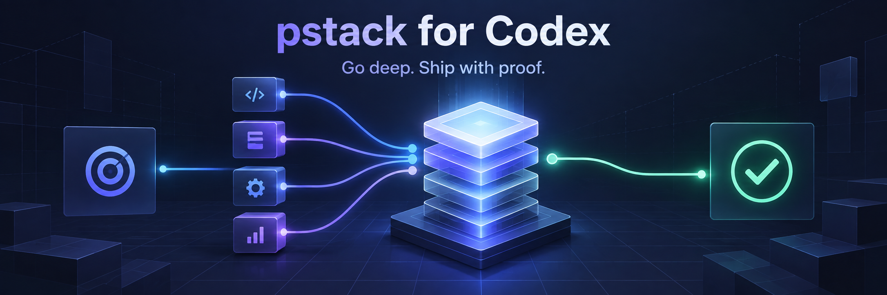

<div align="center">
  

  <p><strong>A Codex-native port of Lauren Tan's pstack engineering workflows.</strong><br>
  Investigate deeply, choose the right playbook, delegate deliberately, and finish with evidence.</p>

  [](https://github.com/kalyandechiraju/pstack-codex/actions/workflows/validate.yml)
  [](https://github.com/cursor/plugins/tree/88d47514b82e7c44f00f2b2a72ff6dd12158038c/pstack)
  [](LICENSE)

  [Install](#install) · [Learn pstack](#learn-pstack) · [See the translation](#from-cursor-to-codex) · [Develop the port](#development)
</div>

## What pstack changes

pstack is a **workflow layer, not an app framework**. You keep your language,
architecture, tests, and Git process. pstack gives Codex a disciplined way to
understand the system, design a change, divide work, challenge assumptions, and
prove the result on the surface that matters.

You describe the outcome and its boundaries; the plugin supplies the process.

```text
goal + known context + must-not-change + proof of done + permissions
```

For example:

```text
$poteto-mode Add a watched filter to the existing movie list.
Preserve the current storage format and keyboard controls.
Done means the filter works after reload and the focused tests pass.
Work locally only; do not push, open a PR, merge, or deploy.
```

That last line matters. Editing, publishing, merging, and deploying are separate
permissions—name the boundary you actually want.

## Learn pstack

> **[Open the practical pstack field guide →](docs/pstack-guide.html)**<br>
> A source-checked, interactive walkthrough of setup, prompting, new and
> existing projects, verification, workflows, guardrails, and worked examples.

For the upstream author's operating model, read
[How the author uses pstack](docs/AUTHOR_WORKFLOW_NOTES.md). It distills Parts 1
and 2 of Lauren Tan's guide and preserves links to both source posts.

The supplied guide is preserved unchanged from the provided file. It reviews
upstream **pstack 0.15.0** and uses the original Cursor command and path syntax.
This repository currently ports the pinned **0.15.29** snapshot to Codex. Use the
translation below when following it here.

### The useful mental model

| You provide | pstack provides |
| --- | --- |
| The outcome and non-goals | A task-matched playbook |
| Product and technical constraints | Investigation and design structure |
| A concrete finish condition | Implementation and review roles |
| Permission boundaries | Verification and visible evidence |

Two good ways to begin:

- **New project:** build one thin, runnable, verifiable slice before expanding
  scope. A small end-to-end proof teaches more than a wide scaffold.
- **Existing project:** establish a read-only baseline first. Learn the normal
  launch and test paths, record pre-existing failures, and preserve unrelated
  local work.

<table>
  <tr>
    <td width="50%" valign="top">
      
      <br><strong>One front door</strong><br>
      <sub><code>$poteto-mode</code> reads the goal and selects the workflow. Prompt the job—not the agent choreography.</sub>
    </td>
    <td width="50%" valign="top">
      
      <br><strong>Proof over confidence</strong><br>
      <sub>Tests, logs, screenshots, and real-app behavior outrank a confident “done.” Agreement between reviewers is not correctness.</sub>
    </td>
  </tr>
</table>

When several approaches compete, an **arena** compares independent proposals.
When independent pieces can be built safely in isolation, **parallel workers**
can help. More agents are not automatically better; use fan-out only when the
work and evidence justify it.

## From Cursor to Codex

The port preserves upstream intent while adapting discovery, invocation,
workspace paths, model roles, and agent manifests for Codex.

| In the upstream guide | In this Codex port |
| --- | --- |
| `/poteto-mode` | `$poteto-mode` |
| `/architect` | `$architect` |
| `/create-verification-skill` | `$create-verification-skill` |
| `.cursor/skills/` | `.agents/skills/` |
| Cursor model rules | `~/.codex/pstack-models.toml` |

The generated defaults use real Codex model slugs: `gpt-5.6-luna` for fast
work and `gpt-6-astra` for judgment, both at `xhigh` reasoning (the `large`
budget). Review panels pair the two. `$setup-pstack` writes semantic role
tables, panel arrays, and the chosen budget as valid TOML; see
[`config/pstack-models.toml.example`](config/pstack-models.toml.example).

## Install

Add this GitHub repository as a Codex marketplace, then install the plugin:

```bash
codex plugin marketplace add kalyandechiraju/pstack-codex --ref main
codex plugin add pstack-codex@pstack-codex
```

Start a new Codex task so it discovers the installed skills. Invoke the main
workflow with `$poteto-mode` and configure model roles with `$setup-pstack`.
The installable package is [`plugins/pstack-codex`](plugins/pstack-codex).

Verify the installation:

```bash
codex plugin list --marketplace pstack-codex
```

## Update

Refresh the Git marketplace snapshot and reinstall the plugin, then start a new
Codex task:

```bash
codex plugin marketplace upgrade pstack-codex
codex plugin add pstack-codex@pstack-codex
```

## Optional custom agents

Custom agents are separate Codex configuration files because the plugin
manifest does not register them. To add them to one project:

```bash
git clone https://github.com/kalyandechiraju/pstack-codex.git
mkdir -p /path/to/your-project/.codex/agents
cp pstack-codex/plugins/pstack-codex/agents/*.toml /path/to/your-project/.codex/agents/
```

Use `~/.codex/agents/` instead for user-level agents.

## Troubleshooting

- If the marketplace is missing, rerun the `codex plugin marketplace add`
  command and inspect `codex plugin marketplace list`.
- If the plugin is listed but its skills are absent, reinstall it and start a
  new Codex task; skill discovery happens at the task boundary.
- If `$setup-pstack` cannot write `~/.codex/pstack-models.toml`, grant Codex
  access to that file or copy `config/pstack-models.toml.example` there
  manually.
- The two custom agents are intentionally separate from plugin installation;
  copy their TOML files as shown above when you want them.

## Repository layout

- `vendor/cursor-plugins/pstack/` is the exact upstream archive. Do not edit it.
- `plugins/pstack-codex/` is generated and is the distributable plugin.
- `scripts/port.py` performs the deterministic source-to-Codex transformation.
- `scripts/sync_upstream.py` verifies the vendor hash manifest and can refresh a
  deliberately changed upstream pin.
- `config/compatibility-allowlist.json` records every mechanical compatibility
  transform.
- `.agents/plugins/marketplace.json` is the canonical repo/team marketplace;
  root `marketplace.json` is kept as an identical convenience copy.
- `docs/` explains the port boundary and refresh process and contains the
  interactive field guide.

## Development

```bash
python3 scripts/port.py
python3 scripts/sync_upstream.py --check
python3 scripts/run_plugin_validator.py plugins/pstack-codex
python3 -m unittest discover -s tests -v
```

The generator is the source of truth for `plugins/pstack-codex`; changes to a
generated file should be made in the generator or allowlist and regenerated.
When the Codex runtime is installed locally, `run_plugin_validator.py` invokes
the official plugin validator first. CI uses the checked-in dependency-free
compatible validator when the runtime is unavailable.

## Attribution and license

The upstream pstack content is MIT-licensed and remains attributed to Lauren
Tan. See [`NOTICE`](NOTICE), [`LICENSE`](LICENSE), and the vendored
[`LICENSE`](vendor/cursor-plugins/pstack/LICENSE).
